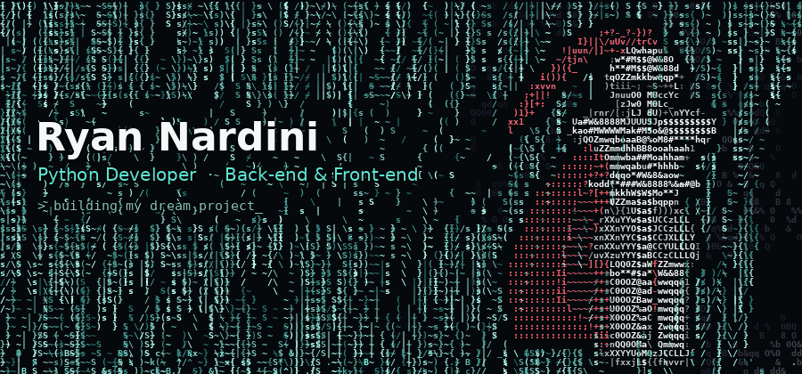

<p align="center">
  
</p>

```python
class Ryan:
    role   = "Python Developer (Back-end & Front-end)"
    base   = "Brasil 🇧🇷"
    stack  = ["Python", "HTML", "CSS", "JavaScript", "SQL", "Git"]
    focus  = "Construir sistemas completos, do servidor à interface"

    def now(self):
        return "Estudando, construindo e publicando projetos novos 🎯"
```

## 🛠️ Stack


## 📌 Projetos

| Projeto | Descrição | Tech |
|---|---|---|
| [**Agro-Tech**](https://github.com/nardiniryan5-ai/Agro-Tech) | Plataforma em Python para gestão de plantações, drones e insumos | Python |

<!-- Adicione novos projetos aqui, uma linha por projeto -->

## 📊 GitHub Stats

<p align="center">
  
  
</p>

<p align="center">
  
</p>

---

<p align="center"><code>$ echo "Vamos construir algo juntos?"</code></p>
